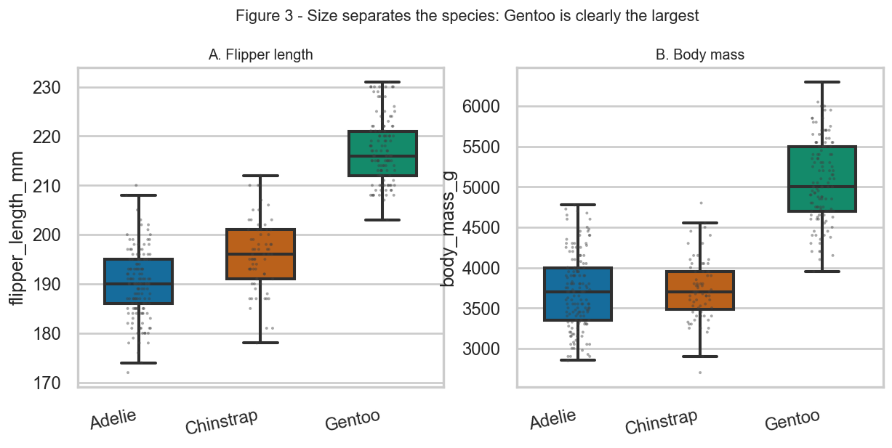
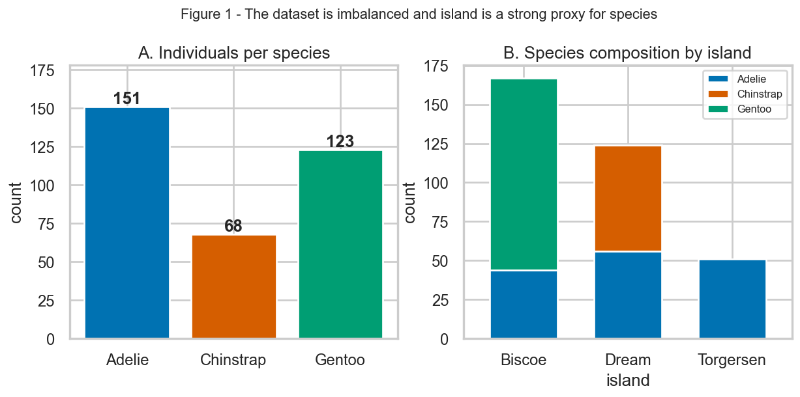
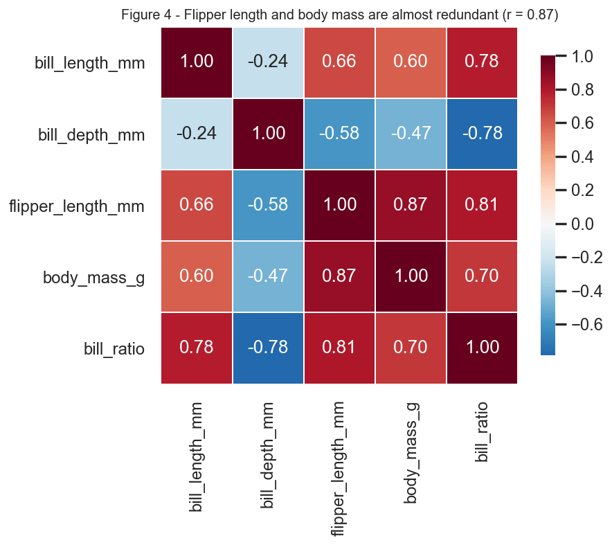

# Can body measurements predict penguin species?

A reproducible analysis of the **Palmer Archipelago (Antarctica) penguins**
dataset, answering one question:

> **Given only a penguin's bill length, bill depth, flipper length and body
> mass, can we identify its species — and which measurement carries the most
> information?**

**Author:** ZHU QINYI (MC64890) · **Course:** CISC7204 Practice 09
**Status:** ✅ Completed

---

## In 30 seconds

| | |
|---|---|
| **Purpose** | Test whether four cheap body measurements can identify a penguin's species, and find which measurement matters most. |
| **Data** | 344 Palmer Archipelago penguins (3 species, 3 islands, 2007–2009), CC0 licence. 342 used after dropping 2 rows with missing measurements. |
| **Method** | 5-fold stratified cross-validation of a scaled logistic regression and a 400-tree random forest. |
| **Main finding** | Species is almost perfectly predictable from measurements alone — **98.8% ± 1.1%** cross-validated accuracy — and **bill length** is the most informative feature (importance 0.42). |
| **Limitation** | Species and island are confounded (Gentoo only on Biscoe, Chinstrap only on Dream), so this describes **these three islands**, not penguins in general. |

**Run it in three commands:** `pip install -r requirements.txt` → `python analysis.py` → open `figures/`.

---

## The problem

Morphometric measurements are cheap to collect, while genetic or behavioural
species identification is expensive. If a handful of caliper and scale
readings can separate the species reliably, then field surveys can be largely
automated and mislabelled records can be flagged for review.

This project therefore asks a *classification* question (how well can species
be predicted from measurements?) and an *interpretation* question (which
measurements actually carry the signal?). It is deliberately framed as a
baseline study: the goal is a defensible, fully reproducible result — not a
state-of-the-art model.

## Key findings

### 1. Measurements alone identify species almost perfectly

| Model | 5-fold CV accuracy | Held-out accuracy |
|---|---|---|
| Logistic regression (scaled) | **98.8% ± 1.1%** | 100% (n = 86) |
| Random forest (400 trees) | 97.7% ± 1.2% | 100% (n = 86) |

> ⚠️ **Read the held-out column with care.** A 100% score on 86 rows sounds
> impressive but is not evidence that the problem is "solved": with only
> 342 rows and near-perfect class separation, a single test split is a very
> low-variance estimate. The 5-fold cross-validated numbers are the honest
> headline, which is why they are quoted first.

### 2. Bill length is the most informative single measurement

Random-forest feature importance:

| Feature | Importance |
|---|---|
| `bill_length_mm` | 0.42 |
| `flipper_length_mm` | 0.35 |
| `bill_depth_mm` | 0.17 |
| `body_mass_g` | 0.06 |


*Figure 5 — the out-of-fold confusion matrix and the feature-importance
ranking. Only 8 of 342 individuals are misclassified.*

### 3. Species separate along two axes: bill shape and body size

Gentoo is the easiest species to identify because it is separated on *both*
axes at once — it is much larger and has a uniquely shallow bill:

| Species | Bill length | Bill depth | Flipper length | Body mass | n |
|---|---|---|---|---|---|
| Adelie | 38.8 mm | 18.4 mm | 190.0 mm | 3,701 g | 151 |
| Chinstrap | 48.8 mm | 18.4 mm | 195.8 mm | 3,733 g | 68 |
| Gentoo | 47.5 mm | **15.0 mm** | **217.2 mm** | **5,076 g** | 123 |


*Figure 2 — bill length against bill depth. Gentoo occupies a band of its own;
Adelie and Chinstrap are separated mainly by bill length.*



*Figure 3 — Gentoo is ~27 mm longer in flipper and ~1.4 kg heavier than
Adelie on average.*

### The one limitation that matters

**The data cannot support a causal or generalisable claim.** Two concrete
reasons, both quantified from the run:

1. **Confounded groups.** Species and island are almost perfectly aligned in
   this dataset (Gentoo appears only on Biscoe; Chinstrap only on Dream).
   A classifier cannot distinguish "this is a Gentoo" from "this was
   measured on Biscoe", so the 98.8% figure describes *these islands*, not
   penguins in general.
2. **Remaining Adelie/Chinstrap overlap.** 26 of the 68 Chinstrap penguins
   have a bill length in the 42–48 mm band where Adelie also occurs, and
   all 8 misclassifications are Adelie/Chinstrap confusions. The two
   species differ by only 0.07 mm in mean bill depth, so that feature
   cannot help.

A further practical constraint: `sex` is missing for 9 of the 342 retained
rows, so any sex-based comparison is unbalanced. The species model does not
use `sex` and is unaffected.

### Supporting figures



*Figure 1 — the classes are imbalanced (151 / 68 / 123) and island is a near
proxy for species. This is why stratified cross-validation is used.*



*Figure 4 — flipper length and body mass are 87% correlated, so they carry
partly redundant information and their individual importances should not be
read as independent effects.*

---

## Dataset source and usage permissions

| | |
|---|---|
| **Dataset** | Palmer Archipelago (Antarctica) penguins |
| **Original study** | Gorman KB, Williams TD, Fraser WR (2014). *Ecological Sexual Dimorphism and Environmental Variability within a Community of Antarctic Penguins (Genus Pygoscelis).* PLoS ONE 9(3): e90081. [doi:10.1371/journal.pone.0090081](https://doi.org/10.1371/journal.pone.0090081) |
| **Data package** | Horst AM, Hill AP, Gorman KB (2020). *palmerpenguins: Palmer Archipelago (Antarctica) penguin data.* R package v0.1.0. [doi:10.5281/zenodo.3960218](https://doi.org/10.5281/zenodo.3960218) |
| **Homepage** | https://allisonhorst.github.io/palmerpenguins/ |
| **File used** | `penguins.csv` |
| **Licence** | **CC0 1.0 Universal** (public domain dedication) — free to use, modify and redistribute, including commercially, with no permission required |
| **Why it is safe to publish** | CC0 data, no personal data, no credentials. The raw CSV is committed to this repository so the analysis is reproducible offline. |
| **Attribution** | Given above as academic courtesy, and repeated in `analysis.py` and `results/metrics.json`. |

**No sensitive information is included in this repository.** There are no
passwords, API keys, tokens, personal data or licence-restricted datasets —
the notebook and scripts read only the committed CC0 CSV.

---

## Methods and tools

**Environment**

| Tool | Version | Role |
|---|---|---|
| Python | 3.8.3 | Runtime |
| pandas | 1.0.5 | Data loading and wrangling |
| NumPy | 1.18.5 | Numerical operations |
| scikit-learn | 0.23.1 | Models, cross-validation, metrics |
| SciPy | 1.5.0 | scikit-learn dependency |
| Matplotlib | 3.2.2 | Figures |
| Seaborn | 0.10.1 | Statistical plots |

**Pipeline**

1. **Load** `data/penguins.csv` (344 rows × 8 columns) exactly as distributed.
2. **Clean.** Drop the 2 rows missing a body measurement → **342 rows**.
   Add a derived `bill_ratio` feature. The 11 rows missing `sex` are labelled
   explicitly rather than silently imputed.
3. **Explore.** Class balance by species and island; bill length vs bill
   depth; size distributions; feature correlation matrix.
4. **Model.** Two deliberately simple baselines — a standard-scaled logistic
   regression and a 400-tree random forest.
5. **Evaluate.** 5-fold **stratified** cross-validation (stratification is
   required because the classes are imbalanced 151/68/123), plus a
   stratified 75/25 held-out split. Out-of-fold predictions are used for the
   confusion matrix so that every row is scored by a model that did not
   train on it.
6. **Report.** Metrics are written to `results/metrics.json`, so the numbers
   in this README are generated by the code rather than typed by hand.

**Reproducibility.** `RANDOM_STATE = 42` is used for the train/test split,
the random forest and the cross-validation folds, so re-running reproduces
the numbers above exactly.

**Design choices worth noting.** Stratified folds rather than plain K-fold,
because a plain split can produce a fold containing very few Chinstrap
samples. Out-of-fold predictions rather than a single test set, because 342
rows make any single split noisy. A logistic regression baseline alongside
the random forest, because if a linear model already achieves 98.8% then the
extra complexity of the forest is not buying accuracy — it is bought for the
interpretability of the confusion matrix.

---

## Instructions for running the analysis

### Prerequisites

Python 3.7+ (developed on 3.8.3) and `pip`. No GPU required; a full run
takes a few seconds.

### Step 1 — Get the code

```bash
git clone https://github.com/ZHU-QINYI/data-science-project.git
cd data-science-project
```

### Step 2 — Create an isolated environment (recommended)

```bash
python -m venv .venv

# Windows (PowerShell)
.venv\Scripts\Activate.ps1

# macOS / Linux
source .venv/bin/activate
```

### Step 3 — Install dependencies

```bash
pip install -r requirements.txt
```

### Step 4 — Run the analysis

```bash
python analysis.py
```

**Expected output.** The script prints a section-by-section log and finishes
with a summary. It writes:

| Path | Contents |
|---|---|
| `figures/fig1_dataset_overview.png` | Class balance and species-by-island composition |
| `figures/fig2_bill_scatter.png` | Bill length vs bill depth (the key plot) |
| `figures/fig3_size_by_species.png` | Flipper length and body mass distributions |
| `figures/fig4_correlation_heatmap.png` | Feature correlation matrix |
| `figures/fig5_model_performance.png` | Confusion matrix and feature importance |
| `results/metrics.json` | All metrics, machine-readable |
| `results/summary.txt` | Human-readable run summary |

The run should end with:

```
Headline result   : Logistic regression achieves 98.8% 5-fold cross-validated accuracy
                    (held-out test accuracy 100.0%)
Top feature       : bill_length_mm
```

### Step 5 (optional) — Open the narrative notebook

```bash
jupyter notebook notebooks/penguins_analysis.ipynb
```

`notebooks/penguins_analysis.ipynb` is the narrative companion to
`analysis.py`. It is committed **with outputs already executed**, so it can
also be read directly on GitHub. To regenerate it from scratch:

```bash
python tools/build_notebook.py
```

### Troubleshooting

| Symptom | Fix |
|---|---|
| `ERROR: data/penguins.csv not found` | Run the script from the repository root, not from inside `figures/` or `notebooks/`. |
| `ModuleNotFoundError` | The virtual environment is not active, or `pip install -r requirements.txt` has not been run. |
| Different numbers than the README | Check for a different package version (`pip freeze`) and confirm `RANDOM_STATE` is still 42. |

---

## Repository structure

```
data-science-project/
├── README.md                      ← this file
├── LICENSE                        ← MIT (code); data is CC0
├── requirements.txt               ← pinned dependencies
├── analysis.py                    ← end-to-end reproducible pipeline
├── .gitignore
├── data/
│   └── penguins.csv               ← raw data (CC0), committed for reproducibility
├── notebooks/
│   └── penguins_analysis.ipynb    ← narrative notebook, outputs executed
├── figures/
│   ├── fig1_dataset_overview.png
│   ├── fig2_bill_scatter.png
│   ├── fig3_size_by_species.png
│   ├── fig4_correlation_heatmap.png
│   └── fig5_model_performance.png
├── results/
│   ├── metrics.json
│   └── summary.txt
└── tools/
    └── build_notebook.py          ← regenerates the executed notebook
```

## Licence

Code in this repository is released under the **MIT Licence** (see
`LICENSE`). The penguins dataset is **CC0 1.0** — see
[Dataset source and usage permissions](#dataset-source-and-usage-permissions).

## Declaration of AI usage

An AI assistant (DeepSeek) was used to help draft and review this code,
notebook and README, in line with the course's AI declaration requirement.
The analysis design, dataset choice and interpretation were directed by the
author, and every number reported above is generated by running
`analysis.py`, not by the AI.
